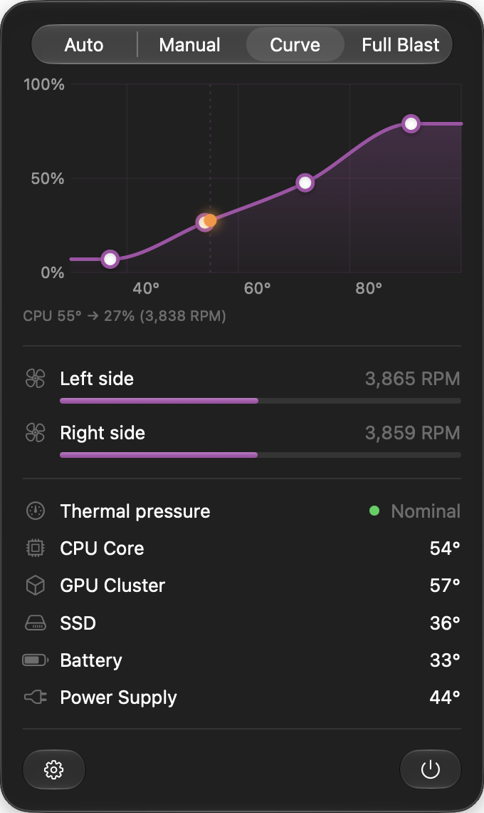
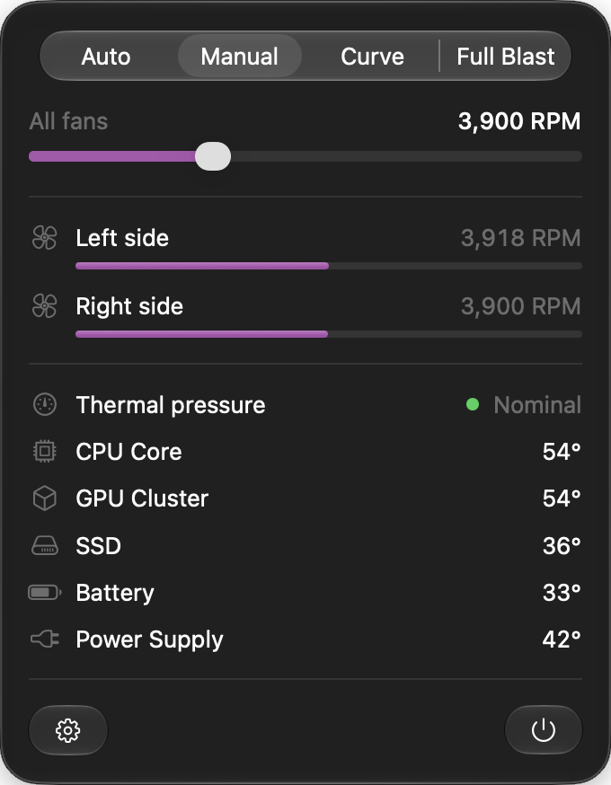
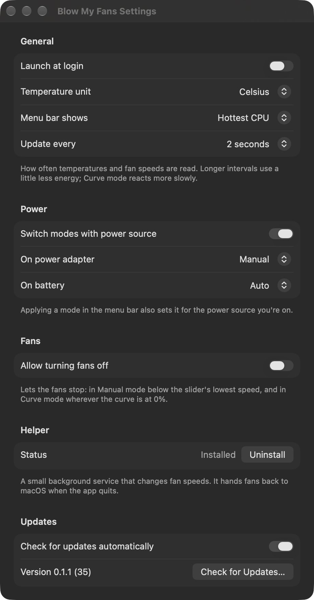

<p align="center">
  
</p>

<h1 align="center">Walter</h1>

<p align="center">
  Temperatures and fan control in your menu bar, for Apple silicon Macs.<br>
  <a href="https://walter.whyredfire.dev">Website</a> ·
  <a href="https://github.com/whyredfire/Walter.app/releases/latest/download/Walter.zip">Download</a> ·
  <a href="https://github.com/whyredfire/Walter.app/releases">Releases</a>
</p>

<p align="center">
  
  
</p>

## Features

- **Four modes:** Auto (macOS runs the fans), Manual (one slider for every fan), Curve (fans follow a
  curve you draw against CPU temperature) and Full Blast. Browse them freely; nothing changes until
  you press Apply.
- **Fan curve editor:** drag points to shape the curve, double-click to add or remove them. The curve
  stays smooth and never decreases, and follows a smoothed CPU temperature so short spikes don't make
  the fans surge.
- **Temperatures:** CPU, GPU, SSD, battery and more, with readable names for each Mac model. The menu
  bar can show the hottest CPU, any sensor, or just the icon.
- **Thermal pressure:** shown in the panel, with a coloured dot on the menu bar icon when macOS starts
  throttling.
- **Safe:** fans go back to macOS when Walter quits, crashes or the Mac sleeps. If macOS won't take
  them back yet, they run at full speed until it does.
- **Light:** reads only what's on screen; well under 1% CPU in the background, and the helper sleeps
  while it has nothing to do.
- **Updates itself** with signed [Sparkle](https://sparkle-project.org) updates.

<p align="center">
  
</p>

## Install

Requires an Apple silicon Mac with macOS 26 or later.

With [Homebrew](https://brew.sh):

```sh
brew tap whyredfire/walter https://github.com/whyredfire/Walter.app
brew install --cask walter
```

Or by hand:

1. Download [`Walter.zip`](https://github.com/whyredfire/Walter.app/releases/latest/download/Walter.zip),
   unzip it and move Walter to `/Applications`.
2. Walter isn't notarized, so macOS blocks the first launch. Choose **Open Anyway** in
   System Settings › Privacy & Security, or run:
   ```sh
   xattr -dr com.apple.quarantine /Applications/Walter.app
   ```
3. Open Walter. The first time you apply a mode other than Auto, it installs its helper and asks for
   your administrator password.

Updates installed by Walter itself aren't blocked.

To uninstall, run `brew uninstall --cask walter` if you used Homebrew. Otherwise remove the helper in
Settings (or run `sudo /Applications/Walter.app/Contents/Resources/helper-tool.sh uninstall`), then
delete Walter.

## Contributing

Found a bug or have an idea? [Open an issue](https://github.com/whyredfire/Walter.app/issues). Pull
requests are welcome too.
